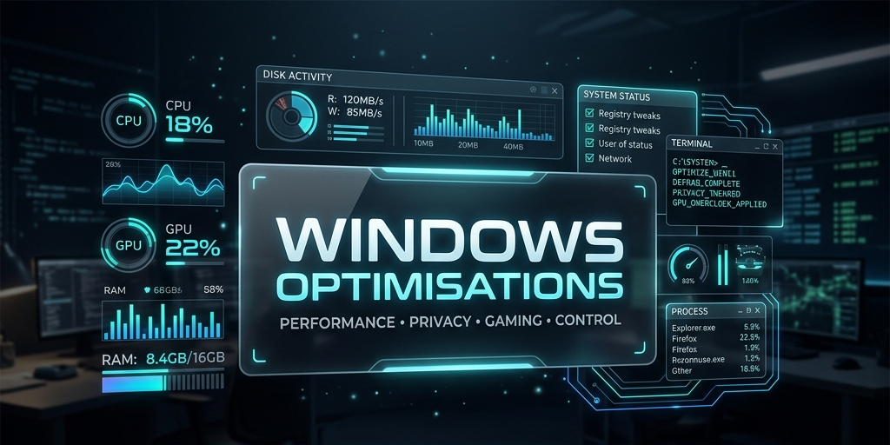

<div align="center">

<!-- ANIMATED CAPSULE-RENDER VENOM HEADER -->


<br>



<br><br>

<!-- ANIMATED TYPEWRITER BOOT SEQUENCE -->
[+%26+10+Profiles+Active;%5B+0.095s+%5D+OK+%3A+Native+.NET+10+%26+WPF+Dashboard+Online;%5B+0.142s+%5D+OK+%3A+Zero-Telemetry+Offline+Pipeline+Verified;%3E+SYSTEM+STATUS+%3A+READY+%E2%96%88)](https://github.com/YTxFSGAMERz/WinAurex)

<br>

<kbd>&nbsp;Windows Engineering Framework&nbsp;</kbd> &nbsp;•&nbsp; <kbd>&nbsp;Rollback-Safe&nbsp;</kbd> &nbsp;•&nbsp; <kbd>&nbsp;PowerShell + C# WPF&nbsp;</kbd> &nbsp;•&nbsp; <kbd>&nbsp;Open Source&nbsp;</kbd>

<br>

<a href="https://winaurex.tech/"></a>
&nbsp;
<a href="https://winaurex.tech/studio/"></a>

<br><br>

<!-- BADGE GRID — TWO-TONE DARK+NEON -->
<p align="center">
  <a href="https://github.com/YTxFSGAMERz/WinAurex/actions/workflows/publish.yml"></a>
  <a href="#core-architecture"></a>
  <a href="#safety--rollback-engine"></a>
  <a href="#core-architecture"></a>
  <br>
  <a href="https://winaurex.tech/compatibility_matrix/"></a>
  <a href="https://winaurex.tech/compatibility_matrix/"></a>
  <a href="https://winaurex.tech/dashboard_architecture/"></a>
  <br>
  <a href="#observability--telemetry"></a>
  <a href="#safety--rollback-engine"></a>
  <br>
  <a href="LICENSE"></a>
  <a href="#core-architecture"></a>
</p>

</div>

<!-- ═══ ANIMATED DIVIDER ═══ -->


<h2 align="center">⬛ THE C# & WPF EVOLUTION (V2.0)</h2>

<div align="center">

> WinAurex unites a lightweight PowerShell engine with a compiled **C# WPF Desktop Platform** backed by strict architecture boundaries.

| 🚀 MAJOR CAPABILITIES | 🛡️ SAFETY & RELIABILITY |
| :--- | :--- |
| **MVVM Architecture:** Clean separation of UI and business logic. | **Transactional Execution Engine:** Immutable pre-execution snapshots. |
| **WPF Dashboard UI:** Responsive, high-contrast cyber-aesthetic client. | **Validation & Dry-Runs:** Dependency conflict detection before execution. |
| **xUnit Test Suites:** Automated verification covering capability providers. | **Immutable Journaling:** Event-sourced JSON audit trails for every operation. |
| **Optimization Profiles:** Gaming, Workstation, Minimal, and Enterprise. | **Contracts Abstraction:** Clean dependency injection and loose coupling. |

</div>

<!-- ═══ ANIMATED DIVIDER ═══ -->


<h2 align="center">⚡ QUICK START</h2>

<div align="center">

Get up and running in under 60 seconds.

</div>

```text
1. Download the latest release from the Releases Tab.
2. Extract the archive to your preferred directory.
3. Launch the compiled desktop application or run the quick launcher:
   .\WinAurex.App.exe --elevated
   # Or for the PowerShell GUI dashboard:
   .\Start.bat
```

<!-- ═══ ANIMATED DIVIDER ═══ -->


<h2 align="center">🛡️ WHY TRUST WINAUREX?</h2>

<div align="center">

Modifying operating system parameters requires complete transparency and zero guesswork.

| 🔒 SECURITY PRINCIPLE | 🔍 HOW WE ENFORCE IT |
| :--- | :--- |
| **Offline-First** | WinAurex requires **zero** internet connection to optimize. No telemetry beacons. |
| **Reversible State** | Every altered key or service is logged into a `.json` manifest for 1-click rollback. |
| **100% Open Source** | The entire C#, XAML, and PowerShell codebase is public for auditing. |
| **No Blackbox Binaries** | Transparent MVVM patterns, open scripts, and automated xUnit test coverage. |

</div>

<!-- ═══ ANIMATED DIVIDER ═══ -->


<h2 align="center">⬛ WHAT WINAUREX IS</h2>

<div align="center">

<!-- RED MANIFESTO TYPING ANIMATION -->
[](https://github.com/YTxFSGAMERz/WinAurex)

</div>

<br>

WinAurex is a modular state management and observability-first framework. Modern operating systems ship saturated with background telemetry, redundant scheduled tasks, and sub-optimal scheduling defaults. WinAurex puts fine-grained control back into the hands of the hardware owner.

<div align="center">

```text
[ USER ] ──▶ [ PROFILES ] ──▶ [ EXECUTION ENGINE ] ──▶ [ JOURNAL & SNAPSHOTS ] ──▶ [ OS CORE ]
```

</div>

<!-- ═══ ANIMATED DIVIDER ═══ -->


<h2 align="center">⬛ CORE ARCHITECTURE</h2>

<details open>
<summary><b>📡 [ SYSTEM INFRASTRUCTURE BLUEPRINT ]</b></summary>
<br>

```text
📦 WinAurex.slnx (Strict Layered .NET Architecture)
 ┣ 📂 WinAurex.App/            # WPF / WinUI 3 UI Layer & ViewModels
 ┣ 📂 WinAurex.Services/       # Business Logic & Orchestration
 ┣ 📂 WinAurex.Infrastructure/ # Capability Providers (Registry, Services, PowerShell)
 ┣ 📂 WinAurex.Core/           # Validation, Dry-Run, & Safety Engines
 ┣ 📂 WinAurex.Contracts/      # Shared Interfaces & Event Bus
 ┗ 📂 WinAurex.Tests/          # xUnit Test Suites
```

*Architectural Boundary Enforcement: The ExecutionEngine coordinates a strict execution pipeline: Validation → Dry Run → Authorization → Execution → Journaling. No bypassed layers.*

</details>

<!-- ═══ ANIMATED DIVIDER ═══ -->


<h2 align="center">⬛ MODULE ECOSYSTEM</h2>

<div align="center">

<!-- SCANNING ANIMATION -->
[](https://github.com/YTxFSGAMERz/WinAurex)

<br>

| 🎮 GAMING DOMAIN | 🛡️ PRIVACY DOMAIN |
| :--- | :--- |
| **Focus:** MMCSS scheduling, GPU priority, input responsiveness | **Focus:** Diagnostic telemetry blocks, tracking prevention |
| **Includes:** Game Mode enforcement, GameDVR stripping | **Includes:** Windows Recall neutralization, Cortana hardening |
| **Safety:** Native API tracking with zero blackbox injection | **Safety:** Policy-level disables reversible without breaking updates |

<br>

| 🌐 NETWORK DOMAIN | 📦 STORAGE & DISK DOMAIN |
| :--- | :--- |
| **Focus:** Bandwidth allocation, packet throttling removal | **Focus:** Disk I/O efficiency, BitLocker prevention, pagefile |
| **Includes:** TCP window parameters, Delivery Optimization caps | **Includes:** Component cleanup, temp purges, TRIM validation |
| **Safety:** Snapshot manifest reversible | **Safety:** Zero destructive formatting |

</div>

<!-- ═══ ANIMATED DIVIDER ═══ -->


<h2 align="center">⬛ SAFETY & ROLLBACK ENGINE</h2>

<div align="center">

<!-- GREEN MATRIX SAFETY PIPELINE ANIMATION -->
[](https://github.com/YTxFSGAMERz/WinAurex)

</div>

<br>

Absolute control requires absolute safety. WinAurex is engineered with a **Transactional State Architecture**. Every modification functions as an isolated operation mapped to an immutable "undo" instruction *before* execution starts.

* 🛑 **NO** destructive service deletion.
* 🛑 **NO** irreversible registry wiping.
* 🛑 **NO** hidden scheduled task removal.

<!-- ═══ ANIMATED DIVIDER ═══ -->


<h2 align="center">⬛ PERFORMANCE PHILOSOPHY</h2>

<table align="center">
  <tr>
    <th align="center">❌ WHAT WINAUREX AVOIDS</th>
    <th align="center">✔ WHAT WINAUREX PRIORITIZES</th>
  </tr>
  <tr>
    <td>
      • Fake RAM cleaners that purge working sets<br>
      • Placebo registry overrides<br>
      • Spaghetti scripts without error handling<br>
      • Opaque background telemetry<br>
      • Blind service deletion
    </td>
    <td>
      • <b>Native .NET & C# Performance</b><br>
      • Non-blocking asynchronous UI (MVVM)<br>
      • Automated xUnit test reliability<br>
      • Local Observability & Event Journaling<br>
      • Rollback safety & manifest validation
    </td>
  </tr>
</table>

<!-- ═══ ANIMATED DIVIDER ═══ -->


<h2 align="center">⬛ DEPLOYMENT FLOW</h2>

<div align="center">

<!-- CYAN DEPLOYMENT ANIMATION -->
[](https://github.com/YTxFSGAMERz/WinAurex)

<br>

</div>

```text
PS> .\WinAurex.App.exe --elevated
[ OK ] C# Execution Engine Initialized
[ OK ] Capability Providers Resolved via DI
[ OK ] WPF Dashboard UI Rendered
```

<!-- ═══ ANIMATED DIVIDER ═══ -->


<h2 align="center">⬛ THE ARCHITECTURAL ENGINE</h2>

<div align="center">

> **"A script that modifies the operating system without transactional state tracking is an operational liability."**

WinAurex solves the broken-script dilemma by decoupling optimizations into atomic **Capability Providers** coordinated by a unified **Execution Pipeline**. Rather than executing blind deletions, every registry value, service start-type, and AppX package state is captured into an event-sourced JSON journal before changes occur.

If an operation encounters a dependency conflict or if the user requests a reversion, the **RestoreEngine** parses the snapshot journal to systematically revert every touched registry hive and system service back to its original baseline.

</div>

<!-- ═══ ANIMATED DIVIDER ═══ -->


<h2 align="center">⬛ OBSERVABILITY & SYSTEM DIAGNOSTICS</h2>

Built-in diagnostics measure real system performance natively without third-party tracking overhead.

<div align="center">
  <kbd>DPC Latency Proxy</kbd> &nbsp;|&nbsp; <kbd>Boot Duration</kbd> &nbsp;|&nbsp; <kbd>CPU Queue Length</kbd> &nbsp;|&nbsp; <kbd>Memory Commit</kbd> &nbsp;|&nbsp; <kbd>GPU Scheduling</kbd> &nbsp;|&nbsp; <kbd>Background Tasks</kbd>
</div>

<!-- ═══ ANIMATED DIVIDER ═══ -->


<h2 align="center">⬛ DOCUMENTATION & GUIDES</h2>

<div align="center">

[](https://winaurex.tech/architecture_blueprint/) &nbsp; [](https://winaurex.tech/compatibility_matrix/) &nbsp; [](https://winaurex.tech/registry_reference/)

[](https://winaurex.tech/architecture_blueprint/#9-corerestore-system-restore--rollback-core) &nbsp; [](https://winaurex.tech/architecture_blueprint/#logging--restore-strategy) &nbsp; [](https://winaurex.tech/myths_and_anti_patterns/)

<br>

<a href="https://winaurex.tech/"></a>
&nbsp;
<a href="https://winaurex.tech/studio/"></a>

</div>

<!-- ═══ ANIMATED DIVIDER ═══ -->


<h2 align="center">🤝 FOR DEVELOPERS & CONTRIBUTORS</h2>

<div align="center">

WinAurex is built on strict software engineering patterns using **MVVM**, **Dependency Injection**, **Event Busing**, and shared **Contracts**.

* 🏗️ Check out [ARCHITECTURE.md](ARCHITECTURE.md) to understand bounded contexts.
* 📝 Read [CONTRIBUTING.md](CONTRIBUTING.md) for PR guidelines and local development instructions.
* 🧪 Help expand xUnit test suites and add new `CapabilityProvider` implementations.

</div>

<!-- ═══ ANIMATED DIVIDER ═══ -->


<h2 align="center">⬛ ROADMAP</h2>

<div align="center">

<b><code>[ PHASE 1 ]</code></b> &nbsp; Core Architecture & Safety Engine (✔ COMPLETED)<br>
<b><code>[ PHASE 2 ]</code></b> &nbsp; Observability Layer & System Diagnostics (✔ COMPLETED)<br>
<b><code>[ PHASE 3 ]</code></b> &nbsp; C# WPF Client & Web Studio (🚀 V2.0 RELEASED)<br>
<b><code>[ PHASE 4 ]</code></b> &nbsp; WinGet Packaging & Distribution Automation

</div>

<!-- ═══ ANIMATED DIVIDER ═══ -->


<h2 align="center">⬛ CREDITS & AUTHOR</h2>

<div align="center">


<br><br>

[](https://github.com/YTxFSGAMERz)

<br>

> *Eradicate software bloat. Maximize hardware responsiveness. Maintain complete user sovereignty.*

<br>

<a href="https://github.com/YTxFSGAMERz">
  
</a>
&nbsp;&nbsp;
<a href="https://t.me/FFShaikh69">
  
</a>
&nbsp;&nbsp;
<a href="https://wa.me/917778906798">
  
</a>

</div>

<br><br>

<!-- ═══ ANIMATED DIVIDER ═══ -->


<h2 align="center">🌟 STAR HISTORY</h2>

<div align="center">

[](https://www.star-history.com/?repos=YTxFSGAMERz%2FWinAurex&type=date&legend=top-left)

</div>

<br><br>

<!-- ANIMATED CAPSULE-RENDER WAVING FOOTER -->
<div align="center">


</div>
